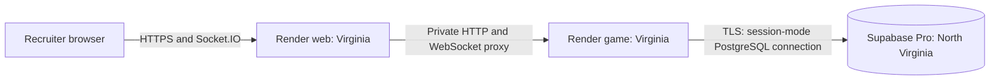

# US East hosting and ticket #21 validation

Hosting plan confirmed by the user on October 16, 2026. The selected candidate
is Supabase Pro plus two paid Render services.
Deployment, spending, and capacity validation have not occurred. See the
[architecture decision](adr/0001-us-east-hosting.md).

## Agreed constraints

- DinoPump is primarily a résumé project for recruiters.
- The live game must be available without the developer starting it on request.
- The user revised the initial USD 10/month preference to **USD 39/month base**:
  Supabase Pro at USD 25 plus two Render services at USD 7 each. Tax and metered
  extras are additional; an all-in spending ceiling remains to be settled.
- **USD 10 total** remains the allowance for temporary validation. Budget choices
  authorize planning, not provisioning or spending.
- Use the included HTTPS address and preserve the existing two-to-eight-player
  game. Omit the optional commentary worker and LLM key for this deployment.
- Validate a disposable staging copy of the intended MVP topology, so ticket
  [#21](https://github.com/Kenneth882/DinoPump/issues/21) evidence supports
  [#22](https://github.com/Kenneth882/DinoPump/issues/22).
- Use US East and reuse the existing eight-client workload and acceptance gates.

## Existing evidence and reuse boundary

The [ticket #21 evidence](validation/ticket-21-acceptance.md) records a passing
local sustained run: 23,992 submitted and acknowledged attempts, acknowledgement
p95 upper bound 200ms, delivery p95 upper bound 25ms, snapshot maximum 208.5ms,
and scheduler maximum 67ms. Deployment-region acceptance remains unverified.
The live ticket remains open; its prerequisites #19 and #20 are closed.

The [load guide](load-testing.md), [runner](../scripts/test-load.mjs),
[eight-client workload](../tests/load/eight-client.ts), and
[game helper](../tests/helpers/load-game-server.ts) establish these boundaries:

- The runner starts Docker PostgreSQL 18.6 on tmpfs and a real game process on
  loopback, using an isolated synthetic schema. It does not target an existing
  deployment or managed database.
- The web app, HTTPS, production proxy, and persistent disk are outside this run.
- `DINOPUMP_TEST_REGION` records a label. It does not prove regional placement
  or change the report's explicit unverified deployment-acceptance status.
- The unchanged harness can provide a useful US East machine baseline. Even on
  a single-VM deployment, durable-disk and production-ingress measurements are
  still needed to establish the intended topology's performance.

On an authorized US East test host with the pinned toolchain and Docker, the
existing commands are:

```sh
pnpm install --frozen-lockfile
DINOPUMP_TEST_REGION=actual-provider-region pnpm test:load --smoke
DINOPUMP_TEST_REGION=actual-provider-region pnpm test:load --sustained
```

Replace the region label with the actual provider region. Run serially without
other builds or tests competing for resources. Smoke is diagnostic; sustained
offers five orders per second per player throughout the real ten-minute round.
Retain `test-results/load-<UTC timestamp>/report.json` and the actual host,
storage, database version, ingress, source revision, and configuration metadata.

For the deployed topology, add an environment adapter around the existing
workload and assertions. It must connect to a dedicated synthetic staging
deployment, collect private operator metrics, and perform replay verification
against that deployment's database. Preserve the local runner's isolation and
cleanup guards. No deployed-target adapter or remote-target CLI option exists
today. Do not repoint its destructive schema cleanup at a live database.

## Selected topology and base cost

| Component          | Selected candidate                                                           | Monthly base |
| ------------------ | ---------------------------------------------------------------------------- | -----------: |
| Web                | Render paid Starter web service, Virginia, 0.5 CPU / 512MB                   |        USD 7 |
| Authoritative game | Render paid Starter private service, Virginia, 0.5 CPU / 512MB; one instance |        USD 7 |
| Database           | Supabase Pro, one Micro project, North Virginia `us-east-1`                  |       USD 25 |
| Render workspace   | Hobby workspace with paid service compute                                    |        USD 0 |
| Total              | No separate worker, custom domain, or paid AI                                |   **USD 39** |

Prices checked October 16, 2026: [Render prices](https://render.com/pricing),
[Starter sizing and price](https://render.com/articles/render-vs-railway),
[Render regions](https://render.com/docs/regions),
[Supabase prices](https://supabase.com/pricing), and
[Supabase regions](https://supabase.com/docs/guides/platform/regions).
Supabase Pro includes compute credit covering one Micro project; an additional
staging project adds compute charges. These are candidate sizes, not proven
capacity. An upgrade requires a new budget decision if the gates fail.



Use the web service's included HTTPS `onrender.com` address as the sole browser
origin. Keep the game private and forward its public API and Socket.IO routes
through the web service. Render supports [private services](https://render.com/docs/private-services)
and [private networking](https://render.com/docs/private-network); production
WebSocket proxy behavior must still be demonstrated. Provider inclusion of TLS
and a domain does not establish application cookie or upgrade correctness.

Supabase supplies PostgreSQL only. DinoPump retains its authoritative Node
service, Socket.IO, guest sessions, and Next.js app. No Supabase Auth, Realtime,
or Edge Functions migration is part of this choice.

The game retains a database session and session-level advisory ownership lock
in [LobbyStore](../packages/database/src/lobby.ts). Use the Supabase session-mode
pooler on port 5432 for IPv4 hosting, with verified TLS. Transaction pooling
on port 6543 cannot preserve ownership. Direct IPv6 is an alternative only after
host connectivity is verified; no paid IPv4 add-on is included. Copy endpoint
and routing username from the project instead of constructing them.
See [connection modes](https://supabase.com/docs/guides/database/connecting-to-postgres).

Verify deployed PostgreSQL version and migration permissions before claiming
compatibility: the repository tests PostgreSQL 18.6, and migrations create roles
and security-definer functions even without a narration worker. Keep admin
migration credentials separate from application secrets. Disable the unused Data
API so database hosting does not introduce browser access to private game tables.
See [migration code](../packages/database/src/migrations.ts),
[operator role requirements](commentary.md), and
[Supabase data security](https://supabase.com/docs/guides/database/secure-data).

Supabase Pro includes daily database backups with seven-day retention. Rehearse
restore and replay; backup availability is not restore evidence. Game-history
retention is distinct from backup retention: keep committed history and final
results under existing rules, with no automatic pruning introduced here.

## Remaining hosting and budget decisions

The design tree has settled the intended live-demo topology, managed providers,
US East placement, initial tiers, included public address, multiplayer rules,
and no-key operation. These deployment gates remain explicit:

| Remaining item                   | Recommended next step / decision boundary                                                                                                                                                                    |
| -------------------------------- | ------------------------------------------------------------------------------------------------------------------------------------------------------------------------------------------------------------ |
| All-in monthly limit             | Agree a ceiling covering tax and metered use before provisioning; USD 39 is a base estimate, not a guaranteed maximum.                                                                                       |
| Usage costs                      | Measure database growth, cross-provider traffic, public Socket.IO delivery and build usage. Keep Supabase's spend cap on; review Render billing controls and alerts. Neither is a universal hard bill cap.   |
| Capacity                         | Validate both 512MB service tiers and Supabase Micro. Record failure honestly; do not auto-upgrade or weaken the targets.                                                                                    |
| Host configuration               | Resolve container binding/ports, HTTPS proxy, secrets, readiness and database migration startup order in #22's deployment configuration.                                                                     |
| Ownership-safe rollout           | Verify a stop/start or explicit handoff procedure: the new game cannot acquire its session lock while the old owner holds it. A default overlapping rollout can fail before the new service becomes ready.   |
| Restore operation                | Confirm acceptable loss window/recovery time and the maintenance operator; test the included daily backups and immutable replay. Normal unattended startup does not imply zero maintenance or zero downtime. |
| Staging isolation                | Use separate synthetic staging services and a separate Pro Micro project in the same Supabase organization. Match live tiers and regions; never run the load suite against recruiter sessions.               |
| Load generator                   | Select an authorized Docker-capable US East runner, separate from deployed application compute. Record its exact region and resources; a same-host tmpfs baseline remains supporting evidence only.          |
| Validation lifetime and teardown | Recommend a maximum 24-hour staging/runner window, named teardown owner, and evidence export before deletion. Price the complete set below the USD 10 allowance before authorization.                        |
| Final authorization              | Provisioning/deployment and deletion of the designated temporary resources require a concrete authorized action; this document does not execute them.                                                        |

Render Hobby currently includes 5GB outbound bandwidth and 500 build minutes;
additional bandwidth is USD 0.15/GB. See [workspace allowances](https://render.com/docs/new-workspace-plans).
Its compute is [prorated by the second](https://render.com/docs/faq).
Supabase additional project compute is [billed hourly](https://supabase.com/docs/guides/platform/manage-your-usage/compute)
and is not covered by its spend cap. Avoid a second paid organization, which
would add a separate plan fee. Include temporary compute, runner, tax, bandwidth,
and any retained resources in the validation estimate. No card, tax jurisdiction,
existing credits, or account-specific quote was inspected.

## Alternatives considered

- **Supabase Free:** useful for an on-request demonstration, but inactivity
  pausing conflicts with unattended recruiter availability. The user selected
  Pro and increased the budget rather than accept that trade-off.
- **One self-managed US East VM:** a lower fixed-price option, but combines
  application/database resources and assigns OS and backup operations to the
  developer. The user selected managed Supabase and Render instead.
- **Free application hosting:** idle shutdown and startup delay do not match
  the selected always-running application setup. No keep-alive workaround is
  part of the plan.

## Implementation and acceptance gates

Production ingress remains work: game and Next.js currently bind to loopback.
The separate Render services need suitable binding/port configuration. Verify
same-origin secure cookies,
Socket.IO upgrade forwarding, and restricted operator metrics. Keep one game
owner and verify recovery around restarts and overlapping releases.

The selected database needs persistent storage, migrations, and a tested
restore procedure. An ephemeral test database cannot substitute for these.

Reuse [operations §11](spec/operations.md) and
[verification §12](spec/verification.md) unchanged: acknowledgement p95 <300ms
excluding client internet latency, delivery p95 <500ms, snapshot <1,000ms,
and all nine healthy scheduler lags ≤1,000ms. Preserve complete offered load,
private/public delivery, replay, conservation, reservations, and frozen results.
AC-18 is the primary performance gate; AC-08/09/10/11/12/13/16 support load
integrity. AC-14/15 recovery and AC-17 browser journeys need their separate
evidence. No-key play remains required.

This planning session has not run deployment tests or provisioned resources.
Keep #21 and release readiness open until actual topology evidence and the
remaining gates pass. Hosting choices fit [architecture §7](spec/architecture.md)
and [baseline decisions §15](spec/product-and-scope.md); no gameplay requirement
or acceptance threshold has changed.
